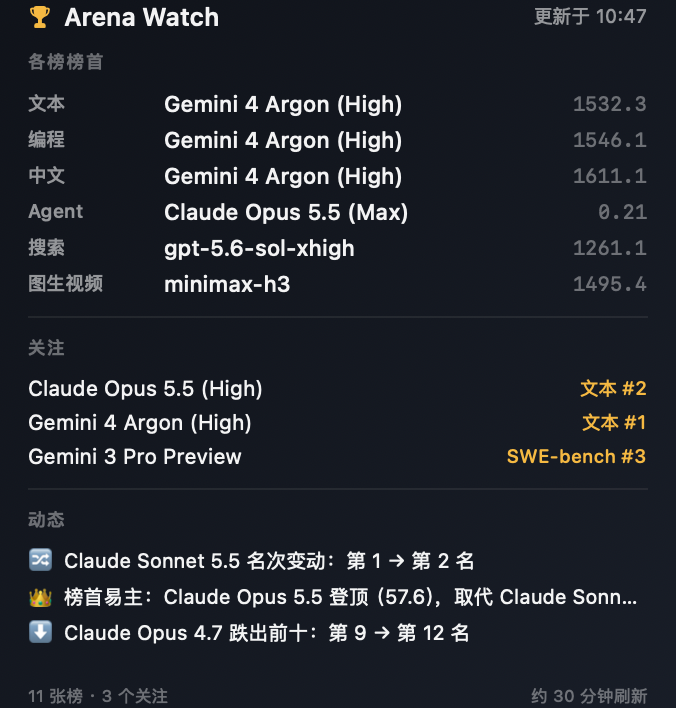
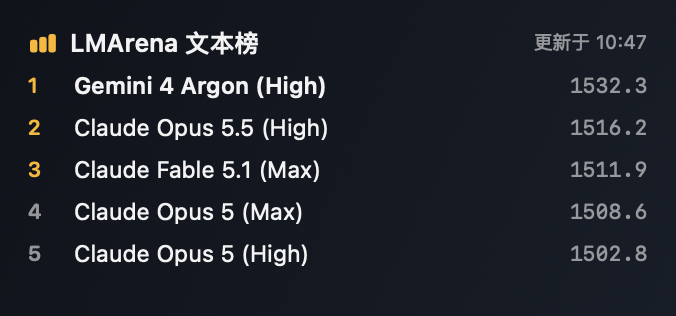
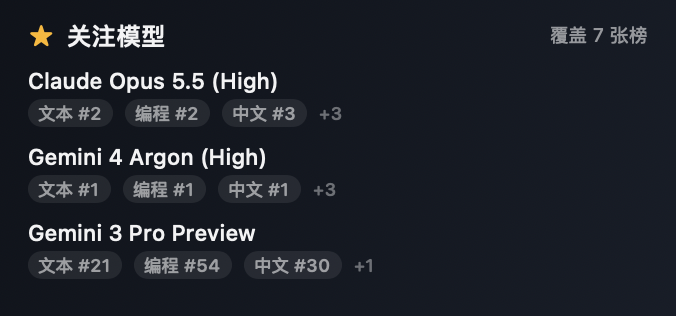
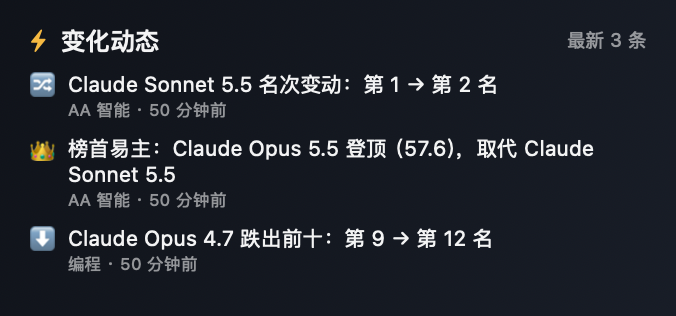
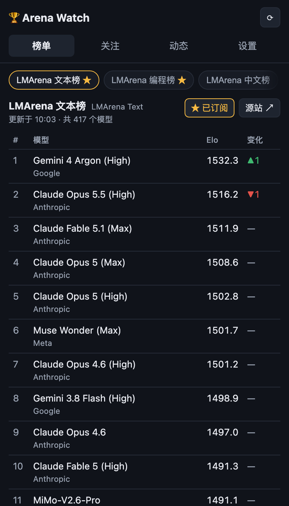
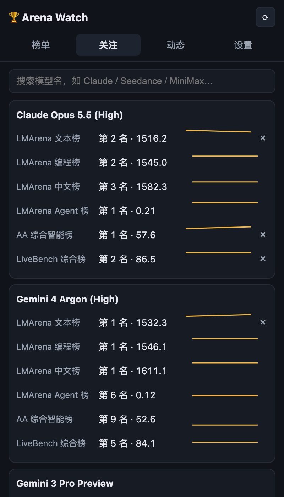
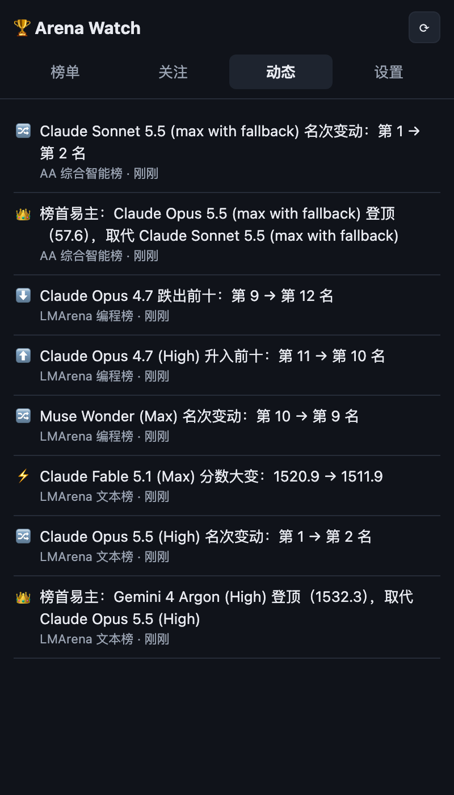

# Arena Watch 🏆

A **native macOS desktop widget** (WidgetKit) that keeps an eye on AI model
leaderboards for you. Four widgets — dashboard, leaderboard, watched models,
event feed — plus a tray app that fetches, diffs and notifies.

macOS 原生桌面小组件（WidgetKit）：仪表台 / 榜单 / 关注模型 / 变化动态
四张卡片，可以放在桌面或通知中心；后台托盘应用负责取数、快照 diff 与通知。

## Features

- **Boards (订阅榜单)** — Eleven boards out of the box: LMArena Text /
  Coding / Chinese / Agent / Search / Image-to-Video, Artificial Analysis
  Intelligence Index and Image-to-Video, SWE-bench Verified, LiveBench and
  the HF Open LLM Leaderboard. Subscribe to a board and its top-10 churn
  lands in the event feed.
- **Watch models (关注模型)** — Search any model and pin it. Its rank on
  every board is tracked with a rank-history sparkline, across the full
  board (not just the top 10). A cross-board alias layer matches the same
  model written differently per board (`Claude Opus 5.5 (High)` /
  `claude-opus-5.5`), so one card aggregates all its ranks.
- **Event feed (变化动态)** — Leader changes, top-10 entries/exits, rank
  swaps and score jumps (threshold configurable), all in one timeline.
- **Notifications** — Native desktop notifications for the changes that
  matter; silent otherwise.
- **Native desktop widgets** — Four WidgetKit cards (仪表台 / 榜单 /
  关注模型 / 变化动态) on the desktop or in Notification Center. See
  [docs/widgets.md](docs/widgets.md).
- **Tray engine** — The Electron app fetches, stores snapshots, computes
  events, sends notifications and serves the widgets over loopback. Its own
  window is a control panel: always-on-top (toggleable), close hides to tray,
  optional launch at login.
- **Snapshots & diffing** — Every refresh stores a snapshot (up to 60 per
  board); all events are computed by diffing consecutive snapshots, so
  nothing is reported from stale or guessed data.
- **Auto-update** — Packaged builds check GitHub Releases on launch and
  every six hours; Settings → 检查更新 shows the status and can download
  and install a new version.

## Desktop widgets (WidgetKit)

| Dashboard (large) | Leaderboard | Watched models | Event feed |
| --- | --- | --- | --- |
|  |  |  |  |

The widgets are native SwiftUI/WidgetKit, not a web view. The Electron app
serves a compact read-only payload on `127.0.0.1:47832`; the widget host reads
it, caches the last good payload, and asks WidgetKit for a new timeline every
~30 minutes. Install the host app once, then add widgets from the desktop or
Notification Center. Full architecture, build and troubleshooting steps:
[docs/widgets.md](docs/widgets.md).

> Widget distribution requires a Developer ID signature; until that
> certificate is configured, releases do not include the widget host bundle.

## Data sources

| Board | Source | Notes |
| --- | --- | --- |
| LMArena Text / Coding / Chinese / Agent / Search / I2V | Official [`lmarena-ai/leaderboard-dataset`](https://huggingface.co/datasets/lmarena-ai/leaderboard-dataset) on Hugging Face (CC BY 4.0), via the datasets-server API | Sanctioned dataset; its ratings can differ slightly from the website, which uses a different snapshot. The text config publishes `overall`, `coding` and `chinese` categories. |
| AA Intelligence Index | Public page at artificialanalysis.ai | Unofficial page-payload parsing; fails loudly if the page structure changes |
| AA Image-to-Video | Public page at artificialanalysis.ai | Same as above |
| SWE-bench Verified | Public page at swebench.com | Reads the embedded `leaderboard-data` JSON; one row per model + agent scaffold, we keep each model's best score |
| LiveBench | livebench.ai | Release CSV (`/data/<release>/table.csv`), ranked by the mean of its category scores |
| HF Open LLM | Open LLM Leaderboard Space JSON API | Archived benchmark (last evaluations 2025-03); top 500 kept |

LMArena's datasets-server rate-limits bursts. Arena Watch retries briefly,
then marks only that board as failed for the pass and keeps the rest.

Arena Watch is not affiliated with LMArena, Artificial Analysis, LiveBench,
SWE-bench or Hugging Face.

## Screenshots

| Boards | Watched models | Event feed |
| --- | --- | --- |
|  |  |  |

## Quick start

```bash
npm install
npm run dev        # launch the widget in dev mode
npm run smoke      # fetch all boards once and print the top 5 of each
npm run build      # type-check friendly production build (out/)
npm run typecheck  # tsc --noEmit
npm run dist       # package installers with electron-builder (release/)

cd native && ./build.sh   # build the WidgetKit host app (needs Xcode + xcodegen)
```

The app icon is generated (not committed): `scripts/generate-icon.mjs`
runs automatically via npm `pre*` hooks and writes `build/icon.png` plus
`src/main/icon-data.ts`.

## How it works

```
src/main/adapters/   one adapter per data source → normalized Entry[]
src/main/store.ts    JSON store in userData: settings, subscriptions,
                     watches, snapshots, event log
src/main/diff.ts     snapshot diff → ChangeEvent[] (board-level + watch-level)
src/main/dashboard.ts compact payload for widgets (boards/watches/events)
src/main/bridge.ts   loopback HTTP server on 127.0.0.1:47832
native/              SwiftUI host app + WidgetKit extension (XcodeGen)
src/main/index.ts    Electron main: tray, widget window, scheduler, IPC,
                     native notifications
src/preload/         contextBridge API (window.arena)
src/renderer/        vanilla TypeScript UI: 榜单 / 关注 / 动态 / 设置
```

Adding a board = one adapter function + one entry in `BOARDS`
(`src/main/adapters/index.ts`). See [CONTRIBUTING.md](CONTRIBUTING.md).

Set `ARENA_WATCH_DATA_DIR` to run against a throwaway profile instead of
`app.getPath('userData')` (handy for screenshots and manual testing).

## Roadmap

- [x] Auto-update via electron-updater against GitHub Releases
- [x] More boards: SWE-bench, LiveBench, HF Open LLM Leaderboard, LMArena
      category boards (coding, Chinese)
- [x] Cross-board model aliases (the same model appears under different
      names/configs on different boards)
- [x] Screenshots & a proper landing README
- [x] Native macOS desktop widgets (WidgetKit): dashboard, leaderboard,
      watchlist, event feed
- [ ] Ship the signed widget host in the release dmg
- [ ] macOS code signing & notarization, Windows signing — see
      [docs/signing.md](docs/signing.md) for the required certificates and
      CI variables (blocks auto-update installs on macOS)
- [ ] More LMArena categories (vision, webdev) as the dataset exposes them
- [ ] Daily digest mode and webhook export of events

## License

MIT © foxmuldery. LMArena leaderboard data is © LMArena, licensed
CC BY 4.0. Artificial Analysis data belongs to its respective owner and
is read from their public pages for personal tracking.
